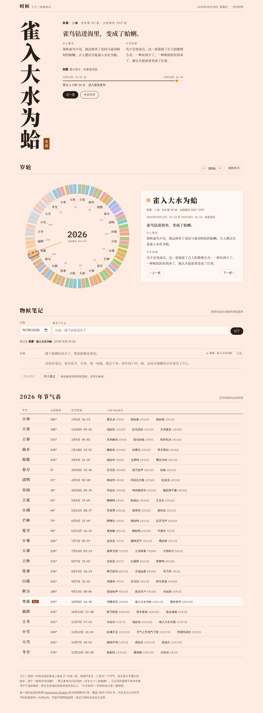
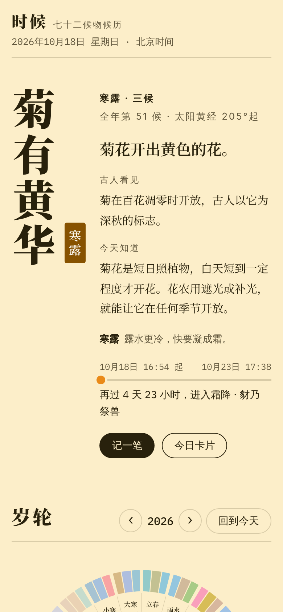
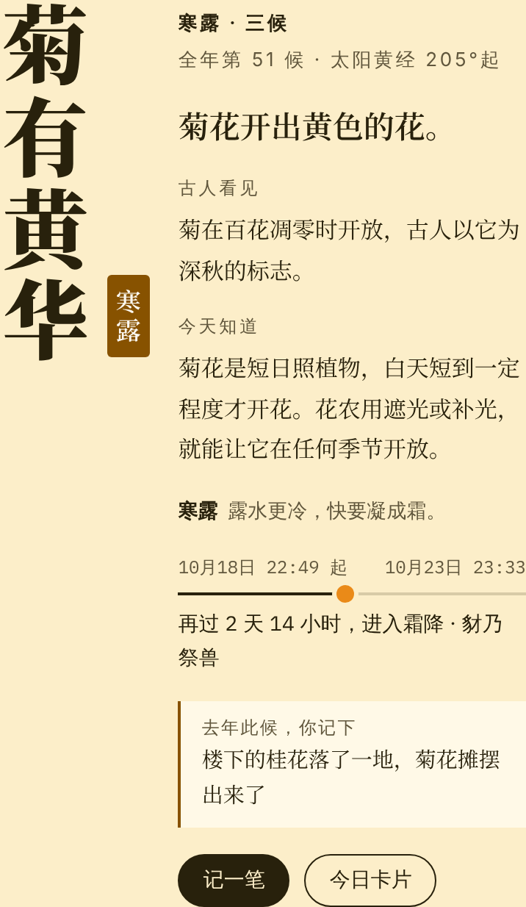
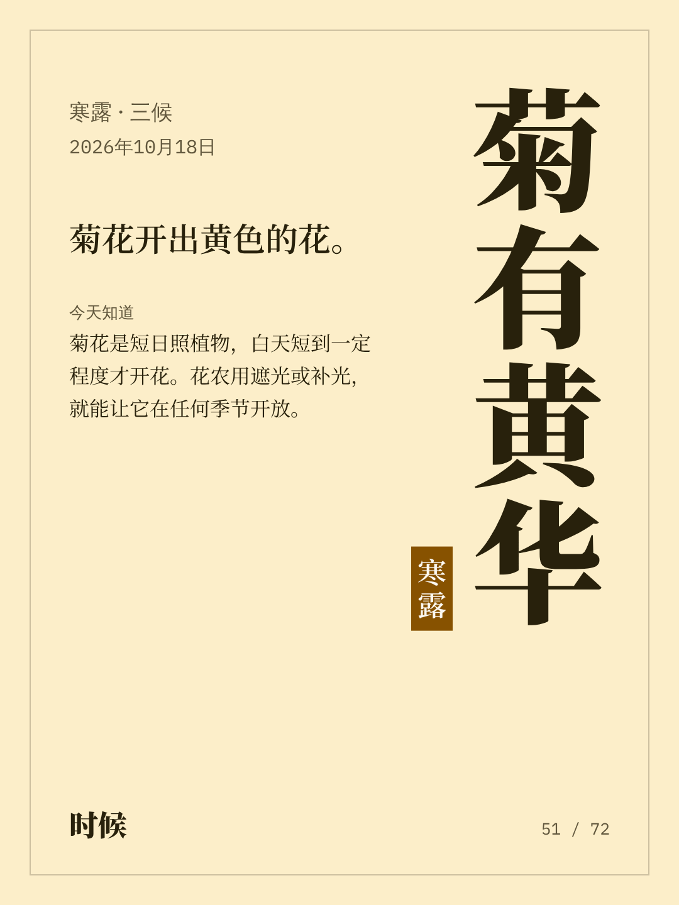

# 时候

一个七十二候物候历。打开就能看到今天是哪一候，比如寒露三候「菊有黄华」。每一候都配有白话解释、古人看见了什么，以及今天的科学怎么解释。页面的底色跟着当前这一候走，每五天换一次。



| 手机 | 一年后的同一候 | 今日卡片 |
|---|---|---|
|  |  |  |

## 能做什么

- **今天**：竖排的候名和节气印章，「古人看见 / 今天知道」两栏，到下一候还有多久。
- **岁轮**：一年七十二候排成一圈，每候一种颜色，从顶端的立春开始顺时针走。金色的指针是此刻太阳所在的黄经。点任意一候看详情，也可以切换到 1900–2100 年的任何一年。
- **物候笔记**：记下你看见的花开、鸟来、第一场霜，笔记会按所在的候归类，并在岁轮外圈标出小点。第二年到了同一候，首页会提醒你去年这时记了什么。笔记可以导出、导入 JSON。
- **节气表**：任意一年二十四节气的交节时刻（北京时间），以及每一候的起始日。
- **今日卡片**：生成一张 1080×1440 的竖版图片，适合分享。

## 怎样使用

直接用浏览器打开 `index.html`，不需要安装，也不需要联网。联网时会加载 Noto Serif SC 字体，离线时用系统字体。

笔记保存在浏览器的本地存储里，换设备或清理浏览器前请先导出。同一个页面发布到 claude.ai 上时，笔记会改存在你自己的账号里，只有你能看到，换设备也在。

## 数据从哪里来

- **时刻**：每一候从太阳视黄经到达 5° 的整数倍时开始。时刻用 [Astronomy Engine](https://github.com/cosinekitty/astronomy) 算出，覆盖 1899 年冬至到 2101 年初，取整到分钟后差分编码嵌进页面，约 29KB。和天文台公布的 2025–2026 年节气时刻对比，误差在 1 分钟以内（见 `scripts/check.mjs`）。
- **条文**：用今天通行的版本，源于《逸周书·时训解》，释义参考元代吴澄的《月令七十二候集解》。
- **局限**：七十二候记的是两千多年前黄河中下游的物候，和今天各地的实际情况常有出入，比如桃花、黄鹂和燕子今天都比条文晚。「今天知道」一栏讲的只是一般情形；拿不准的物种比如鴽、反舌、鹖鴠，都写作“一般认为”。

## 开发

```bash
npm ci                         # 开发依赖：astronomy-engine、playwright
npm run build                  # 重新计算候的起始时刻，写进 index.html
npm run check                  # 内容、嵌入数据是否过期、参考时刻、脚本语法、外部资源
CHROME_PATH=/path/to/chrome npm run test:browser   # 在 Chromium 里跑一遍并更新 docs/screenshots/
node scripts/export-artifact.mjs out.html          # 导出为 claude.ai Artifact 的页面源码
```

`index.html` 里有三段由标记包围的数据：`TERMS`（24 个节气）、`PENTADS`（72 候的文字和颜色）和 `TIMES`（由 `npm run build` 生成，不要手改）。
