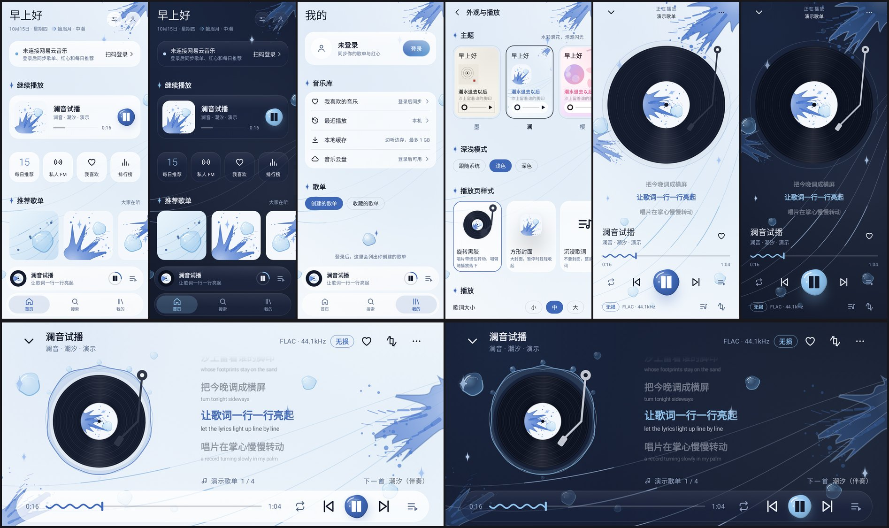

# 澜音

接入网易云音乐的第三方 Android 播放器：竖屏是常规音乐 App，横过来就是 QQ 音乐风格的横屏播放页。

> 当前进度：**M0.13 新主题「格」**。界面、主题、动效和横屏播放页都可以体验；播放的是一个四首歌的演示队列（含纯音乐和超长歌名），还不能登录或出声。完整路线见 [docs/PLAN.md](docs/PLAN.md)。





## 主题

每个主题是一整套视觉语言，不只是换颜色：

| 主题 | 风格 | 卡片 | 进度条 | 播放按钮 | 背景 |
|---|---|---|---|---|---|
| **澜** | 海与月：浅色是晨海（珍珠白、海雾青），深色是夜海（深渊蓝、月光青）；大字用细体 | 磨砂玻璃、大圆角，上沿有一道水面反光；按下时从手指处荡开水纹 | 播放时会起伏的波浪线 | 一颗带高光的水泡 | 光柱从上方斜照、气泡上浮、底部浪涌；首页日期旁是今天的月相和潮汐（大潮 / 小潮），横屏夜里的月亮就是今晚的月相；歌词像浮在水里一样轻轻起伏 |
| **墨**（默认，旗舰） | 黑白、留白、衬线字，唯一的颜色是朱红印章 | 不用卡片，只用发丝线分隔；底栏贴边 | 发丝线 | 线框圆 | 竖屏唱片外一笔圆相；横屏右下远山和雾，全屏时右侧竖排题款加印章 |
| **樱** | 粉紫、软糯 | 柔和投影、超大圆角 | 渐变胶囊 | 渐变软方块 | 飘落的花瓣，右上角伸进一枝樱花 |
| **霓** | 赛博霓虹，只有深色 | 切角、霓虹描边 | LED 灯段 | 发光圆环 | 透视网格和扫描线；横屏地平线上一轮条纹落日 |
| **格** | 新粗野瑞士：米白网格纸、纯黑、信号红、克莱因蓝、警示黄；粗黑体大标题，数字和标签用等宽字；只有浅色 | 直角、2.5dp 粗黑边、偏移的硬投影，按下会压进投影；小节标题前是红底编号「01」；首页斜贴一条滚动字幕 | 方块进度条，带刻度和黄色方块拖柄，时间装在黑框里 | 红色方块 | 十二栏网格、基线和裁切角标；播放页印着巨大的曲目编号，横屏再加一个红圆和一道蓝条；封面是四种瑞士海报构图；当前歌词用黄色荧光块逐字划过，整行微微歪着 |
| **暮** | 七十年代暖色：巧克力棕、焦橙、灰玫瑰、墨绿，芥末黄只做点缀 | 粗描边；只有主角卡片带硬投影，按下会陷进阴影里；深色模式下描边和投影换成暗棕，不刺眼 | 斜纹磁带条，时间是磁带计数器 | 复古方钮 | 条纹落日（夜里沉成余烬色，横屏挂在右侧）和胶片颗粒；封面有彩虹、落日、波浪、雏菊四种 |

所有主题共用一套规则：四级字号、页边距、一屏一个强调色、同一族自绘线性图标（线宽随主题变化）。每个主题都有四种生成封面构图，推荐歌单不会一排都是同一张图。

主题之外，还可以单独选**播放页样式**：旋转黑胶（默认）、方形封面、沉浸歌词、复古卡带。

### 动效
- 点迷你播放条，它会展开成播放页（容器变形），唱片从缩略图长成大唱片；下拉或系统返回手势会让播放页跟手缩小。
- 唱片有惯性：播放时加速转起，暂停时慢慢停下；唱臂带回弹落下。
- 歌词逐行像波浪一样跟上，当前行略微放大并卡拉 OK 式扫色；字号可以在设置里选小 / 中 / 大（默认 18sp：中文字比同字号的英文更满，主流 App 的歌词也大多在 16–18sp）；歌词大小只听这个设置，不跟系统字体大小走，不然系统字号调大的手机上歌词会大得离谱；可以拖动歌词浏览，松手后自动回到当前行，点某一行跳到那里。
- **滑动切歌**：左右滑动唱片（竖屏、横屏都行）或迷你播放条切到上一首 / 下一首，唱片跟手滑走，下一张从另一边滑进来；用按钮切歌也是同样的方向动画。上一首按钮和多数播放器一样：歌放了 3 秒以上先回到开头。
- 竖屏播放页从上到下：「正在播放 · 歌单名」居中的标题栏，唱片和三行歌词（上一句、当前句、下一句，点一下进入全屏歌词），歌名和歌手，整宽的进度线（时间在线下方，数字等宽不跳动），播放控制，最下面一行是音质标签、歌词和旋转按钮。
- 打开播放页时，标题栏、歌词、歌名、进度、控制按顺序升起；播放时唱片边缘每一拍荡出一圈涟漪（墨是墨线，霓是发光管，格是方框），暂停时唱片轻轻退后一点。
- 切歌时，歌名和歌手顺着切歌方向滑出、新的滑进来，新歌的歌词从下往上依次浮现；当前句亮起时会微微上浮。上一首 / 下一首按钮按下会往对应方向推一下，播放模式图标切换时会弹一下。
- 拖动进度条时，歌词跟着手指走到那一句，松手才真正跳过去。
- 横屏是「顶栏、舞台、控制栏」三段：顶栏左边是收起按钮和歌名（像窗口标题），右边是音质、红心和旋转；舞台左边是封面，外圈一圈频谱随音乐跳动，每个主题画法不同（墨是刻度线，澜是双层波浪，樱是小圆点，霓是发光光柱，暮是 VU 表灯块；现在是模拟数据，M2 接上真实音频）；右边是歌词，当前句和封面中心对齐，下面一行是歌单来源和下一首。**点舞台空白处切换全屏**，5 秒不碰也会自动全屏：顶栏和控制栏收起，舞台放大，底部只剩一行歌名和时间，加一道进度细线。横屏时隐藏系统栏；也可以在设置里打开「进入播放页时自动横屏」。
- 纯音乐会显示「纯音乐，请欣赏」，超长的歌名、歌手名会省略，长歌词会换行且放大后不出界。
- 系统字体调大时（很多手机默认就偏大）界面跟着放大，卡片和按钮会随文字长高，放不下的文字会省略，不会被切掉；截图测试里有一套 360dp 宽、1.3 倍字号的全页面检查。

## 编译

需要 JDK 17+。

```bash
./scripts/setup-android-sdk.sh      # 安装 Android SDK 到 ~/android-sdk，并写 local.properties
./gradlew assembleDebug             # → app/build/outputs/apk/debug/app-debug.apk（未压缩，约 60 MB）
./gradlew assemblePreview           # → app/build/outputs/apk/preview/app-preview.apk（R8 压缩，约 3 MB，debug 签名，可直接安装）
./gradlew testDebugUnitTest         # 单元测试
./gradlew recordRoborazziDebug      # 在 JVM 上渲染界面截图 → app/build/outputs/roborazzi/（sweep/ 里是每个主题、每种深浅色的全部页面）
```

如果 Maven Central 限流（HTTP 429），可以改走 Google 的镜像：

```bash
MAVEN_MIRROR=google ./scripts/setup-android-sdk.sh
export ROBOLECTRIC_REPO_URL=https://maven-central.storage-download.googleapis.com/maven2
```

## 说明

仅供个人使用。用的是网易云的非官方接口，不包含任何绕过会员或付费的功能，VIP 歌曲需要登录的账号本身有对应权限。
