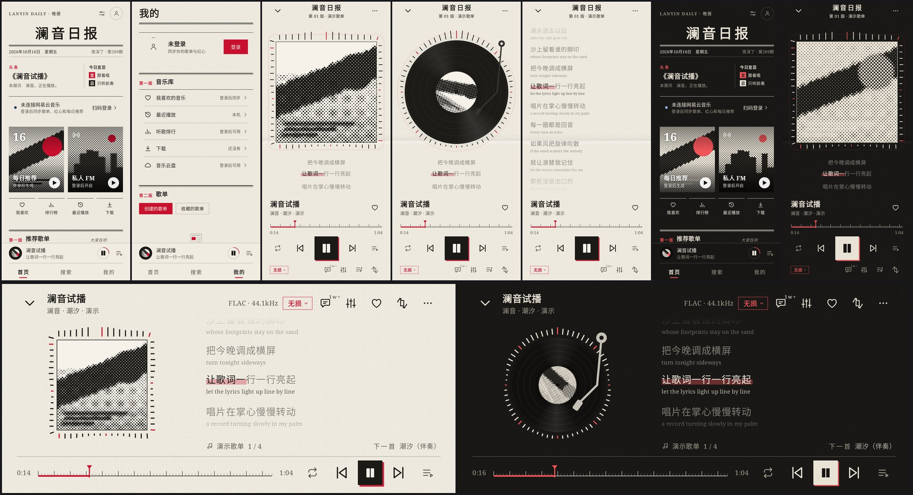
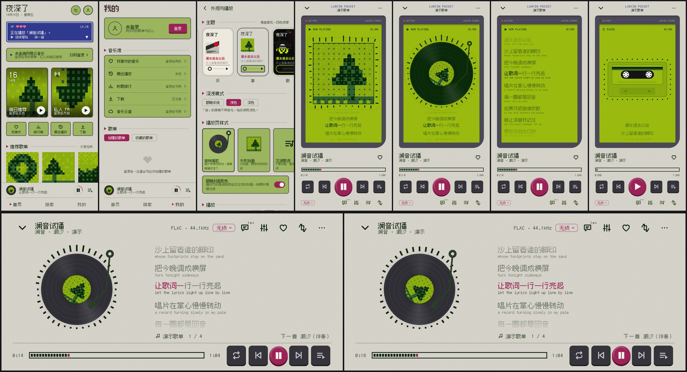
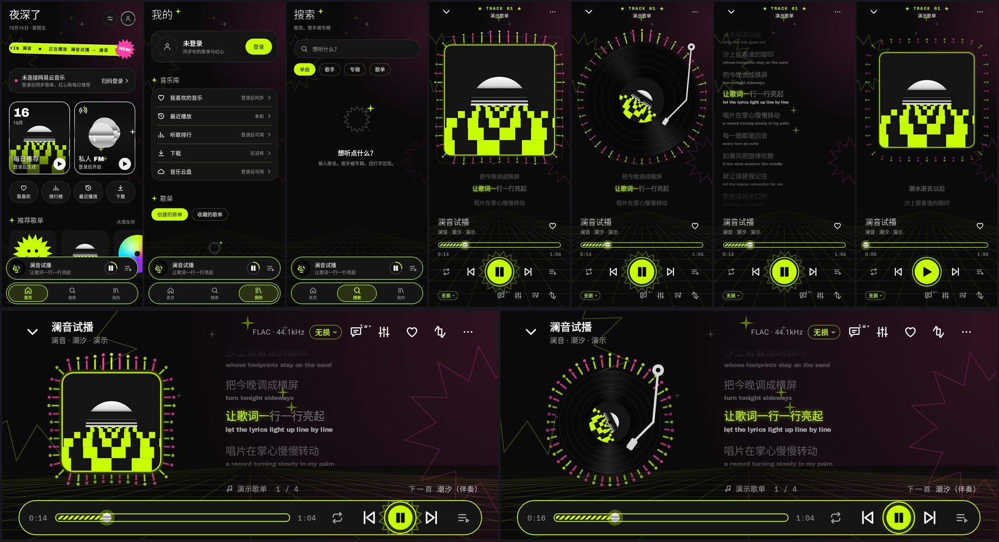
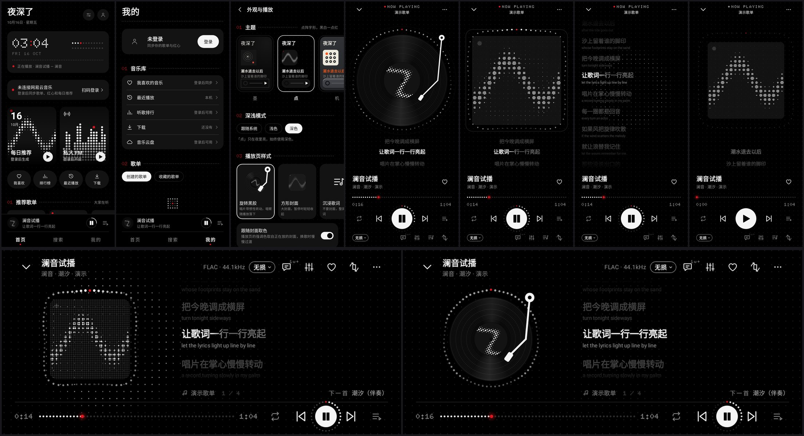
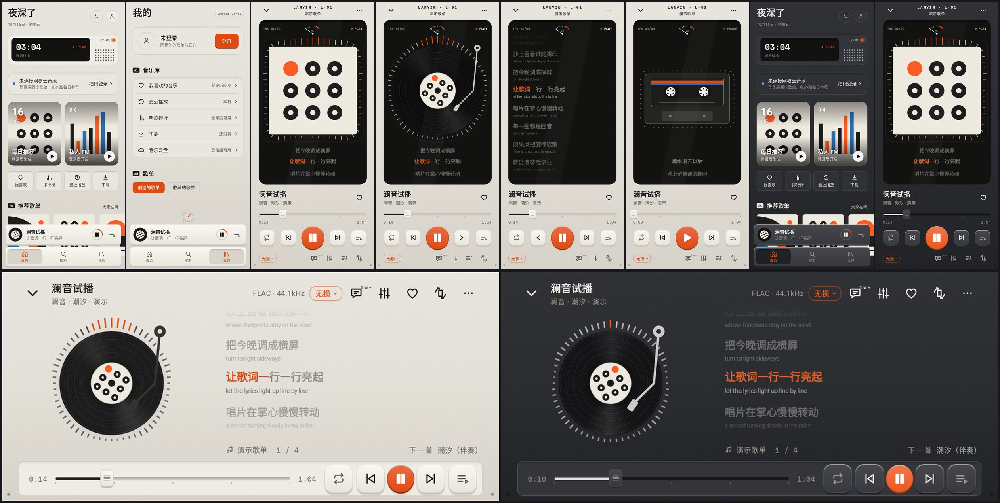
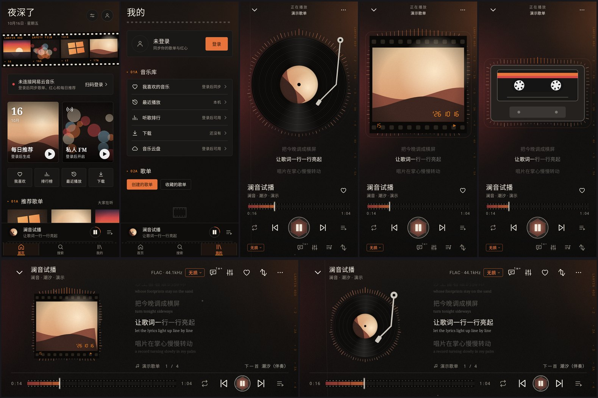
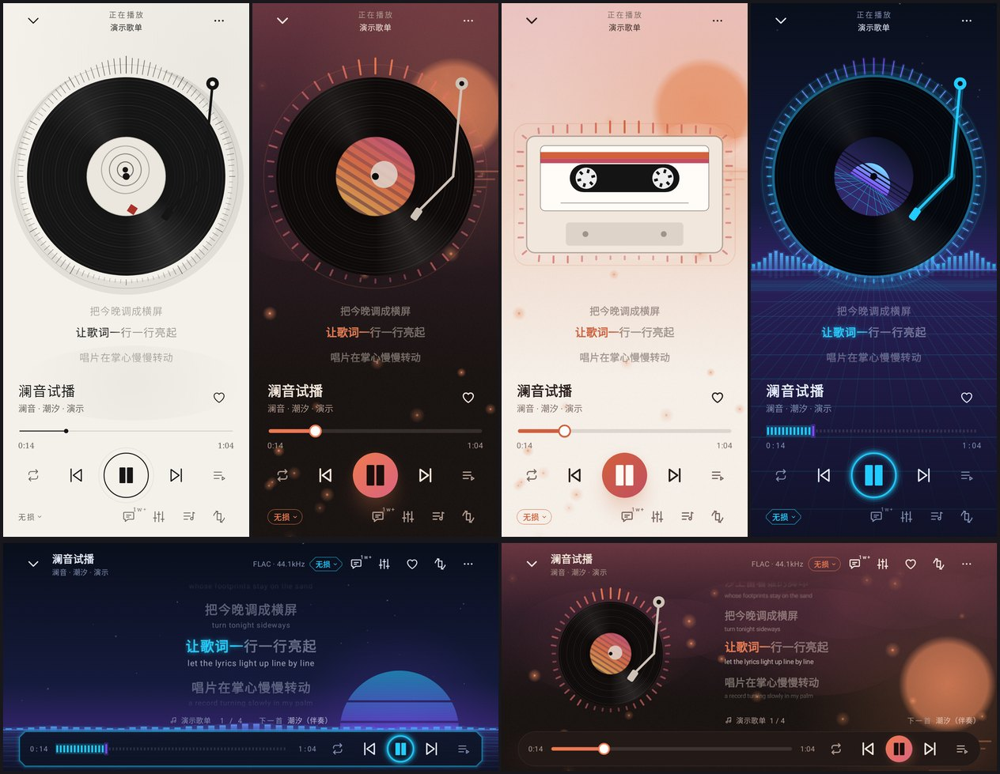
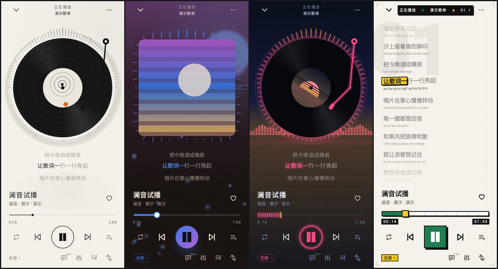
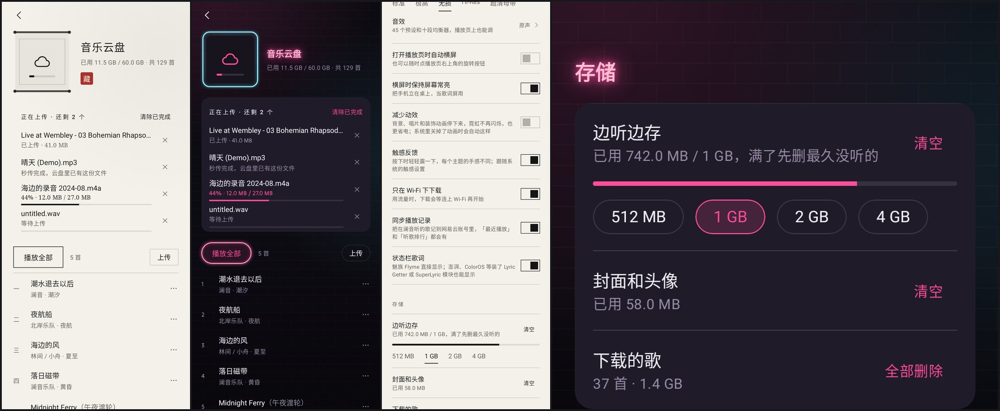

# 澜音

接入网易云音乐的第三方 Android 播放器：竖屏是常规音乐 App，横过来就是 QQ 音乐风格的横屏播放页。

> 当前进度：**M10 动效对上节奏，六个主题补上页面元素**。扫码登录网易云音乐后，可以听每日推荐、私人 FM、我喜欢的音乐、自己的和收藏的歌单、排行榜、歌手、专辑和音乐云盘，搜索单曲 / 歌手 / 专辑 / 歌单；能看和写评论，管理歌单，下载离线听，上传到云盘，播放记录会同步到网易云；有 45 个音效预设，有状态栏歌词。一共十个主题。这一版重写了找拍子的方法：以前是在底鼓上一下一下地抓，现在像人打拍子一样先听出速度和拍点，再在这张「拍网」上落拍，和参考节拍的吻合度从 44% 提到 66%（60 段真实录音实测）；涟漪、播放键和背景闪光的长短跟着速度走，霓和酸的地面网格按拍子滚动，酸的星星轮流在拍点上闪；还修了一个让背景越放越乱跳的问题。点、机、影、报、游、酸六个主题的页面加了各自的元素：点的点阵时钟小组件、机的显示屏面板和喇叭网、影的一条接触印相胶片、报的报头「澜音日报」和头条 + 今日宜忌、游的 RPG 对话框、酸的荧光贴纸跑马灯，小节标题和页面标题也各有记号。完整路线见 [docs/PLAN.md](docs/PLAN.md)。

















## 网易云音乐

App 直接连网易云（本地实现 eapi / weapi 加密，不经过任何服务器）：

- **登录**：扫码登录，二维码可以存到相册，再用网易云「扫一扫 → 相册」识别（同一部手机扫不了自己的屏幕）；也可以试「直接在网易云里打开」，或者在高级选项里粘贴 `MUSIC_U` Cookie。登录凭证用 Android Keystore 的密钥加密保存，不进备份，只发给网易云。
- **能听的**：首页的每日推荐、私人 FM（不想听的跳过会告诉网易云）、推荐歌单（登录前是热门歌单）、排行榜；「我的」里是我喜欢的音乐、创建和收藏的歌单、最近播放；歌手页（热门歌曲）和专辑页；搜索边打字边出结果，可以搜单曲、歌手、专辑、歌单。点哪首就从哪首开始播放整张列表。
- **播放**：歌曲到要播放时才去要播放地址（网易云的地址二十分钟左右就失效；它的音频节点有的只认 http、有的只认 https，连不上会自动换另一种再试），按设置里的「在线音质」要（默认无损，超清母带要 SVIP），没有就自动降一档；听过的歌存在「边听边存」缓存里（默认 1 GB，设置里可以改成 512 MB 到 4 GB），再听不用流量。没有版权或需要 VIP 的歌会提示原因并跳过。
- **后台**：Media3 播放服务，带通知栏、锁屏控制、蓝牙和耳机按键，拔耳机自动暂停，来电等情况自动让出声音。
- **歌词**：有逐字时间（YRC）的歌，扫色跟着每个字唱到的时刻走，而不是匀速扫过整行；其余用 LRC。翻译按时间对齐，网易云开头的作词作曲信息也会显示；加载中显示「歌词加载中」，纯音乐显示「纯音乐，请欣赏」。
- **队列和「⋯」**：播放页和迷你条的队列按钮打开播放队列（点哪首跳到哪首，可以切播放模式）。播放页和每一行歌后面都有「⋯」：收藏、添加到歌单、下载、看评论、去歌手页或专辑页；在自己的歌单里还能把歌删掉，在云盘里能删文件（删除要点两次）。
- **歌单**：「我的 → 创建的歌单」最上面可以新建歌单（可以设成隐私）；自己的歌单右上角「⋯」能改名、删除；别人的歌单和排行榜可以「收藏」。
- **评论**：播放页的评论按钮上带着数量（「1w+」）。评论页分推荐、最热、最新，往下滑自动加载，点赞立刻生效（网易云不同意会退回去），点一条评论就是回复它。
- **下载**：在「⋯」里下载一首，或者在歌单、专辑、歌手页、每日推荐里「下载全部」。下载交给后台服务，通知栏有进度，退出 App 也会接着下；默认只在 Wi-Fi 下下载。下载完的歌播放时直接读本地，不用网。只能试听的 VIP 歌不会下载（不然存下的是 30 秒片段）。下载的文件在 App 自己的目录里，只在澜音里播放。
- **音乐云盘**：在「我的」里，显示用了多少空间，分页加载，能播放、能删除。点「上传」从手机里选歌（可以多选），一首一首传，页面上有进度；网易云已经有同一个文件的会「秒传」。歌名、歌手、专辑从文件标签里读。上传走网易云自己的对象存储，连接全程 https。
- **播放记录**：每首听满半分钟（或短歌的一半）就告诉网易云，账号的「最近播放」和「听歌排行」里会有在澜音听的歌；设置里可以关掉「同步播放记录」。「我的 → 最近播放」可以在「本机」和「网易云」（账号在所有设备上的记录）之间切换；「听歌排行」有最近一周和所有时间。
- **红心**：播放页的红心直接同步到网易云「我喜欢的音乐」。
- **音质**：点播放页上的音质标签（横屏在顶栏）就能换，正在放的歌从当前位置接着放；设置里也能改默认音质。
- **音效**：播放页的音效按钮（或设置里的「音效」）。45 个预设分四组——**曲风**（流行、摇滚、软摇滚、金属、爵士、蓝调、古典、民谣、乡村、国风、嘻哈、R&B、电子、舞曲、俱乐部、Techno、派对、雷鬼、斯卡）、**场景**（LiveHouse、音乐厅、教堂、KTV、录音棚、3D 环绕、8D 环绕、迷幻电音、车载、耳机、夜间）、**人声 · 低音**（人声、清澈人声、重低音、超重低音、低音+高音、高音增强、响度补偿、柔和）、**复古**（黑胶、电子管、卡带、Lo-fi、收音机），每个都有一句说明。经典曲风的均衡曲线来自 VLC 沿用多年的预设（源自 Winamp），按 0.6 的力度用；场景和复古是把均衡和效果组合起来调的。十段均衡器可以直接拖，拖了预设就变成你自己的曲线；滑块有低音增强、环绕、混响、空间大小，「更多效果」里还有回声、动态压缩、温暖（电子管式饱和）、复古窄频、唱片底噪和 8D 旋转。音效在澜音里用软件处理（不依赖手机厂商的音效接口），耳机和外放都有效，加了限幅不会爆音；选「原声」时音频原样通过，一个字节都不改。
- **跟随封面取色**：播放页的强调色（按钮、进度条、歌词高亮，霓的地平线）取自正在放的封面：挑封面里最鲜明的主色，保留色相，再调亮度直到在主题背景上看得清（对比度按 WCAG 4.5:1），换歌时慢慢过渡。黑白灰的封面保持主题原色。设置里可以关。
- **状态栏歌词**：正在唱的那句显示在状态栏。魅族 Flyme 直接支持（歌词写进媒体通知的 ticker，带魅族的两个标志位）；澎湃、ColorOS 等装了 LSPosed 的手机，用 Lyric Getter（配合「墨·状态栏歌词」）或 SuperLyric 模块也能读到；Android 16 以上再加一枚「实时活动」胶囊：胶囊放不下整句，就把一句按标点切成六个字以内的小段，跟着唱到哪里换哪一段，下拉通知能看到整句和歌名。设置里可以关，胶囊也可以单独关；系统关掉了澜音的实时活动时，设置里会提示去打开。
- **存储**：设置里能看到「边听边存」、封面和头像、下载各占多少，可以分别清空；「边听边存」的上限改了立刻生效，超出的先删最久没听的。







## 主题

每个主题是一整套视觉语言，不只是换颜色：

| 主题 | 风格 | 卡片 | 进度条 | 播放按钮 | 背景 |
|---|---|---|---|---|---|
| **墨**（默认） | 黑白、留白、衬线字，唯一的颜色是朱红印章 | 不用卡片，只用发丝线分隔；底栏贴边 | 发丝线 | 线框圆，鼓点时荡出一圈墨线 | 竖屏唱片外一笔圆相和一圈刻度；每个鼓点在纸上晕开一团墨，边缘略深，几秒后淡去；一缕雾横过歌词后面；横屏右下远山和雾，全屏时右侧竖排题款加印章 |
| **霓** | 深夜蓝的底色上电光蓝（#22CCFF）和紫（#7C4DFF），红心是霓虹粉；只有深色 | 切角、霓虹描边 | LED 灯段 | 发光圆环，跟着音量发亮 | 透视网格和扫描线；地平线上是一排随频谱起伏的发光柱（中间低音、两边高音），每个鼓点地平线闪一下、一道光沿着网格冲向你，网格按拍子滚动（每两拍一格）；横屏地平线上一轮蓝紫渐变的条纹落日 |
| **格** | 新粗野瑞士：米白网格纸、纯黑、信号红、克莱因蓝、警示黄；粗黑体大标题，数字和标签用等宽字；只有浅色 | 直角、2.5dp 粗黑边、偏移的硬投影，按下会压进投影；小节标题前是红底编号「01」；首页斜贴一条滚动字幕 | 方块进度条，带刻度和黄色方块拖柄，时间装在黑框里 | 红色方块 | 十二栏网格、基线和裁切角标；播放页印着巨大的曲目编号，横屏再加一个红圆和一道蓝条；封面是四种瑞士海报构图；当前歌词用黄色荧光块逐字划过，整行微微歪着 |
| **点** | Nothing 的点阵语言：纯黑、白、几级灰，唯一的颜色是录音灯那样的一颗红点；数字和英文小标签用点阵字体（Doto），中文用系统黑体；只有深色。开了跟随封面取色，只有那颗红点换成封面的颜色 | 深灰圆角块，不描边不投影；底栏贴边，当前页下面一颗红点 | 一排圆点，放过的亮白，当前位置是一颗带光晕的红点，拖动时附近的点会变大 | 白色圆盘，黑色图标；播放时外面一圈 28 颗小灯从正上方顺时针按音量亮起，鼓点时一起闪 | 一层细密的点阵：每个鼓点从封面后面向外荡开一圈亮起的点，低音越重封面周围越亮；封面像点阵屏一样显示（灰度，只在一格格圆点里亮），没亮的点也隐约可见；频谱是封面外一圈 LED，正上方那颗是红的；标题栏是红点加「NOW PLAYING」 |
| **机** | 一台随身音响，参考 Teenage Engineering 和博朗：暖灰塑料机身、近黑的字、播放键的橙和一点蓝；标签和计数用打字机等宽字（Space Mono）。深色是石墨机身 | 卡片是嵌进机身的面板（顶边一道内阴影）；迷你条、底栏、按钮是凸起的按键，按下会沉到底座上，当前页是按下去的那颗键 | 推子：凹槽里走着一个带三道纹的推钮，拖动时中间那道变橙 | 橙色圆形按键，带底座和高光，跟着音量发光；上一首 / 下一首 / 模式 / 队列也都是按键 | 机身有细微的塑料纹理，播放页底角两颗螺丝；封面和歌词放进机身上的黑色显示屏，屏幕顶栏是曲目计数、一只跟着音量摆动（带一点过冲）的 VU 表和播放状态；频谱是电平条，冲高的地方变橙；标题栏印着「LANYIN · L-01」 |
| **影** | 暗房：近黑底只带一点暖、相纸白、焦橙和一道红色漏光；衬线字；只有深色 | 相纸一样的细边，小圆角；底栏是一截胶片，上沿一排齿孔，当前页是一格曝过光的画框，下面一道日期戳的橙 | 一截胶片：上下两排齿孔，放过的部分曝成橙色，一根亮线是当前位置 | 相机光圈：暂停时叶片收拢，播放时张开并转一个角度，后面透出暖光 | 每秒刷新十二次的颗粒、左边和右上角的漏光（贴着画面边缘亮、很快就暗下去，鼓点时亮起）、暗角、偶尔的灰尘和划痕；播放页右侧竖排印着胶片边码（片名和帧号）；方形封面装在 35mm 底片框里，带齿孔、帧号和傻瓜机的橙色日期戳，播放时在片门里轻轻晃；歌词像电影字幕 |
| **报** | 一张报纸：新闻纸、油墨黑和一种红；全部用衬线字，标题很重；深色是夜刊（深色纸、暖白字、亮一点的红） | 不画框：一篇稿子上面压一道粗线加一道细线，像报纸分栏；底栏贴边，当前页下面一道红笔 | 一把印刷标尺，听过的部分用红笔划了底线，当前位置是一个红色笔尖 | 一块墨色方块，下面的红版印偏了一点，鼓点时偏得更多 | 新闻纸自带的细网点和纤维，播放页中间一道折痕；封面印成 45° 网点的报纸照片（夜刊是浅色网点），黑胶中心也是；标题栏是「澜音日报」和「第 03 版」；正在唱的那句用红色荧光笔划过去；频谱是报纸上的柱状图 |
| **游** | 一台像素掌机：灰色机身、四阶绿屏、A/B 键的洋红和字的藏青；中文和英文都是像素字（缝合像素字体）；只有浅色 | 卡片是一块块小绿屏，外面一圈深色屏框；按钮是洋红的，按下去会沉；底栏贴边，当前页前面一个 ▶ 光标 | 游戏里的血条：深色框里一格一格，当前那格是洋红 | 洋红的 A 键，鼓点时被按一下；上一首 / 下一首 / 模式 / 队列是深色的 D-pad 键 | 播放页是整台机器：带电源灯和「LANYIN STEREO」字样的屏框，里面是有像素格的绿屏，封面按四阶绿抖动显示（真实封面也是），歌词也是像素字；频谱一格一格地长；生成封面是 16 像素的小画 |
| **酸** | Y2K：黑底、荧光绿和亮粉；标题用 Archivo Black 加铬金渐变，标签用等宽字；只有深色 | 卡片是铬金细边，底栏和迷你条是荧光绿边的胶囊，当前页是荧光绿描边 | 荧光绿胶囊，听过的部分是会滚动的斜条纹，当前位置是一颗铬金珠子 | 荧光绿圆盘加一圈外环，跟着音量发光，鼓点时外面炸开一圈星芒 | 通向地平线的荧光绿网格（播放时按拍子朝你滚过来）、画面边上慢慢转的星芒（鼓点时鼓起来）、在拍点上轮流闪的四角星；页面标题和歌名是铬金字；频谱是绿粉相间的光线 |
| **暮** | 晚霞：浅色是暖白纸配赤陶橙到玫瑰色，深色是梅子色的夜；无衬线字 | 柔和的暖色投影、圆角，不描边（深色时边上一道很淡的光） | 渐变胶囊（赤陶到玫瑰） | 渐变圆钮 | 从上往下的晚霞色天空、低低的一轮太阳带光晕（跟着低音鼓起来，横屏在右侧，下面几道水面反光随高音闪烁）、三朵从太阳前面飘过的云、不断升起的暖色光点（鼓点时一起亮）、胶片颗粒；封面是海上落日、层层山丘、光环和百叶窗里的夕照四种 |

六个主题的普通页面也有自己的元素：

| 主题 | 首页 | 小节标题 | 页面标题 |
|---|---|---|---|
| **点** | 点阵时钟小组件：Doto 大字时间（中间两颗红点）、英文日期、24 颗表示一天的小点（过去的亮、这个钟点是红的），下面一行正在播放 | 红色点阵编号「01」，一行虚点引到右侧说明 | 下面一道点线 |
| **机** | 机身面板：一块小显示屏（时间、PLAY / STOP、曲名）、型号「LY-01」和播放时发光的指示灯、钻出来的喇叭网 | 印刷标签「A1」 | 右侧一块「LANYIN LY-01」铭牌 |
| **影** | 一条接触印相：齿孔、橙色边码「LANYIN 400 · SAFETY FILM」、四格照片和帧号，略微歪着 | 橙色帧号「▸ 01A」 | 下面一排齿孔 |
| **报** | 报头「澜音日报」、早报 / 晚报、日期和期号；头条是正在播放的歌，旁边一栏「今日宜忌」（每天不同） | 粗细两道线下「第一版」红字加粗标题 | 下面粗细两道线 |
| **游** | RPG 对话框：藏青底白框，1P、三颗像素心、等级，一句台词和闪烁的 ▼ | ▶ 光标，一行像素点引到说明 | 洋红色硬投影 |
| **酸** | 荧光绿胶囊跑马灯斜贴在页面上，角上拍一张粉色星芒「NEW!」贴纸 | 荧光绿四角星加铬金字 | 铬金字旁一颗绿星 |

所有主题共用一套规则：四级字号、页边距、一屏一个强调色、同一族自绘线性图标（线宽随主题变化）。每个主题都有四种生成封面构图，推荐歌单不会一排都是同一张图。「点」的 Doto、「机」和「酸」的 Space Mono、「酸」的 Archivo Black、「游」的缝合像素字体都是 SIL Open Font License 的开源字体，原样打包在 `app/src/main/res/font`，版权和许可见 [licenses/FONTS.md](licenses/FONTS.md)。

十个主题里「点」「影」「酸」「霓」只有深色，「格」「游」只有浅色。主题之外，还可以单独选**播放页样式**：旋转黑胶（默认）、方形封面、沉浸歌词、复古卡带。

### 动效
- 点迷你播放条，它会展开成播放页（容器变形），唱片从缩略图长成大唱片；下拉或系统返回手势会让播放页跟手缩小。
- 唱片有惯性：播放时加速转起，暂停时慢慢停下；唱臂带回弹落下。
- 歌词逐行像波浪一样跟上，当前行略微放大并卡拉 OK 式扫色；字号可以在设置里选小 / 中 / 大（默认 18sp：中文字比同字号的英文更满，主流 App 的歌词也大多在 16–18sp）；歌词大小只听这个设置，不跟系统字体大小走，不然系统字号调大的手机上歌词会大得离谱；可以拖动歌词浏览，松手后自动回到当前行，点某一行跳到那里。
- **滑动切歌**：左右滑动唱片（竖屏、横屏都行）或迷你播放条切到上一首 / 下一首，唱片跟手滑走，下一张从另一边滑进来；用按钮切歌也是同样的方向动画。上一首按钮和多数播放器一样：歌放了 3 秒以上先回到开头。
- 竖屏播放页从上到下：「正在播放 · 歌单名」居中的标题栏，唱片和三行歌词（上一句、当前句、下一句，点一下进入全屏歌词），歌名和歌手，整宽的进度线（时间在线下方，数字等宽不跳动），播放控制，最下面一行是音质标签、歌词和旋转按钮。
- 打开播放页时，标题栏、歌词、歌名、进度、控制按顺序升起；播放时唱片边缘在听到的每一拍荡出一圈涟漪（墨是墨线，霓是发光管，格是方框；没有明显鼓点的歌就很少），暂停时唱片轻轻退后一点。
- 竖屏的唱片 / 封面外圈也有一圈频谱（以前只在横屏有），背景跟着低音、中音、高音和鼓点动（见上面主题表），播放键也跟着节拍：墨荡出墨线，暮发光，霓的灯管变亮，格的方块跳一下，影的光圈后面亮起来，点的圆盘外一圈小灯随音量亮起，机的橙色按键发光，报的红版印得更偏，游的 A 键被按一下，酸的圆盘外炸开星芒。
- 频谱和涟漪跟着真实的声音走：解码出来的音频先经过一个分析器（每 512 个采样做一次 1024 点 FFT，折成 32 个频段），结果按音频自己的时间戳存着，再按扬声器此刻在放的位置去取，所以画面对的是正在听到的声音，而不是提前几百毫秒解码出来的那部分。
- 拍子是一张「拍网」，像人跟着打拍子：把全频段的起音（底鼓、军鼓、和弦变化、唱出的字都算，高频算得少）攒成最近 6 秒的起音曲线，每 0.1 秒从它的自相关里估一次速度（同时看一倍和半倍的位置，偏向 120 BPM，取最近五次的中位数），再找拍点落在哪里最能对上起音（越近的拍越重要），然后按这张网落拍，每次新估计只把网轻轻拉过去一点（锁相环），差太多才跳过去。所以底鼓空掉的那一拍也有拍子，踩镲和装饰音不会被当成拍。歌刚开始的三秒还没有网，先用底鼓起音顶上；音乐没了律动两秒左右就放掉这张网。用 GTZAN 的 60 段录音和 librosa 的参考节拍比，±70 毫秒内的 F 值从 0.44 提到 0.66。
- 画面跟拍：涟漪、播放键、地平线和光点的闪光在下一拍之前就收住（快歌短、慢歌长），霓和酸的地面网格每两拍滚过一格，并在拍点上对齐；酸的星星轮流在拍点上闪。以前背景里「速度 × 时间」的写法会让网格、光点、雾在音量变化时整段跳位，放得越久跳得越远，现在都改成按速度累加位移。
- 歌词：有逐字时间的歌按字扫色。只有逐行时间的歌（网易云不少歌只有这种），先用整首歌估出演唱速度（每秒唱几个字或词，取各行的第 70 百分位，限制在合理范围内），再按每行的字数算出这一行大约唱多久，在这段时间里扫完；行尾到下一行之间的间奏不再被算进去，所以不会一下子亮完，也不会扫得比人声快。换行时不弹跳。状态栏歌词用同一套时间。没有歌词时分三种情况说：网易云标了纯音乐的是「纯音乐，请欣赏」，网易云没有这首歌词的是「暂无歌词」，没加载下来的是「歌词没能加载，点一下重试」。
- 切歌时，歌名和歌手顺着切歌方向滑出、新的滑进来，新歌的歌词从下往上依次浮现；当前句亮起时会微微上浮。上一首 / 下一首按钮按下会往对应方向推一下，播放模式图标切换时会弹一下。
- 拖动进度条时，歌词跟着手指走到那一句，松手才真正跳过去。
- 横屏是「顶栏、舞台、控制栏」三段：顶栏左边是收起按钮和歌名（像窗口标题），右边是音质、评论、音效、红心和旋转；舞台左边是封面，外圈一圈频谱随音乐跳动，每个主题画法不同（墨是刻度线，暮是柔和的光线，霓是发光光柱，格是方块条）；右边是歌词，当前句和封面中心对齐，下面一行是歌单来源和下一首。**点舞台空白处切换全屏**，5 秒不碰也会自动全屏：顶栏和控制栏收起，舞台放大，底部只剩一行歌名和时间，加一道进度细线。横屏时隐藏系统栏；也可以在设置里打开「进入播放页时自动横屏」。
- 纯音乐会显示「纯音乐，请欣赏」，超长的歌名、歌手名会省略，长歌词会换行且放大后不出界。
- 系统字体调大时（很多手机默认就偏大）界面跟着放大，卡片和按钮会随文字长高，放不下的文字会省略，不会被切掉；截图测试里有一套 360dp 宽、1.3 倍字号的全页面检查。

## 编译

需要 JDK 17+。

```bash
./scripts/setup-android-sdk.sh      # 安装 Android SDK 到 ~/android-sdk，并写 local.properties
./gradlew assembleDebug             # → app/build/outputs/apk/debug/app-debug.apk（未压缩，约 60 MB）
./gradlew assemblePreview           # → app/build/outputs/apk/preview/app-preview.apk（R8 压缩，约 3 MB，debug 签名，可直接安装）
./gradlew testDebugUnitTest         # 单元测试
./gradlew recordRoborazziDebug      # 在 JVM 上渲染界面截图 → app/build/outputs/roborazzi/（sweep/ 里是每个主题、每种深浅色的全部页面）
NETEASE_LIVE=1 ./gradlew testDebugUnitTest --tests '*NeteaseLiveTest'   # 对真实的网易云服务器跑一遍（匿名注册、二维码、搜索、歌词、榜单、拉一段真实音频）
```

如果 Maven Central 限流（HTTP 429），可以改走 Google 的镜像：

```bash
MAVEN_MIRROR=google ./scripts/setup-android-sdk.sh
export ROBOLECTRIC_REPO_URL=https://maven-central.storage-download.googleapis.com/maven2
```

## 说明

仅供个人使用。用的是网易云的非官方接口，不包含任何绕过会员或付费的功能，VIP 歌曲需要登录的账号本身有对应权限。
