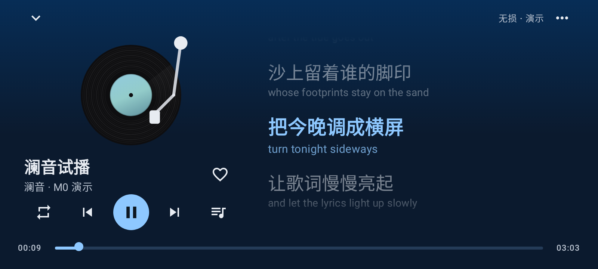
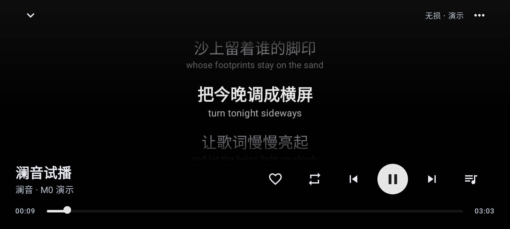
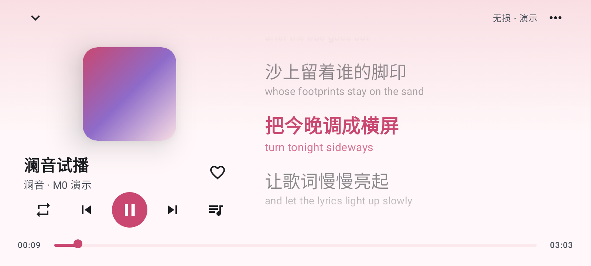
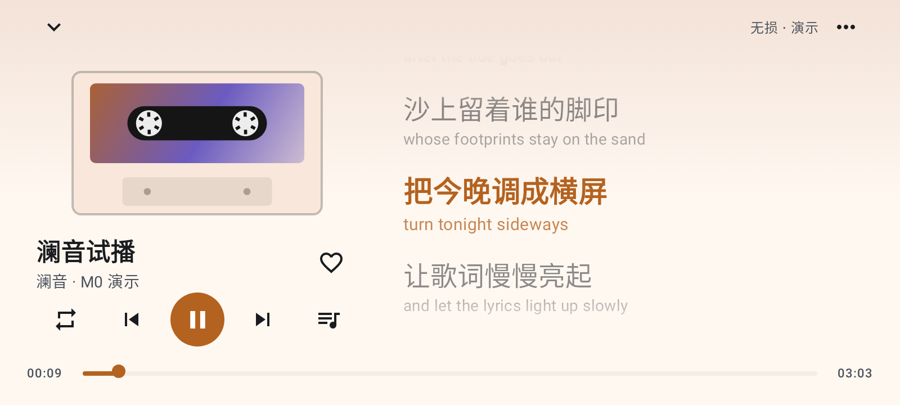

# 澜音

接入网易云音乐的第三方 Android 播放器：竖屏是常规音乐 App，横过来就是 QQ 音乐风格的横屏播放页。

> 当前进度：**M0 工程骨架**。界面、皮肤和导航可以体验，播放的是假数据，还不能登录或出声。完整路线见 [docs/PLAN.md](docs/PLAN.md)。

| 横屏 · 旋转黑胶 · 澜 | 横屏 · 沉浸歌词 · 墨 |
|---|---|
|  |  |
| **横屏 · 方形封面 · 樱** | **横屏 · 复古卡带 · 暮** |
|  |  |

## 皮肤

- **主题皮肤**（整个 App 的配色）：澜（深海蓝，默认）、墨（黑白，深色模式下纯黑省电）、樱、竹、暮，以及 Android 12+ 的「随系统」壁纸取色。每套都有浅色和深色。
- **播放页皮肤**：旋转黑胶（默认，播放时唱臂落下）、方形封面、沉浸歌词、复古卡带。

在首页右上角的 ⚙ → 外观 里切换，设置会保存在本机。

## 编译

需要 JDK 17+。

```bash
./scripts/setup-android-sdk.sh      # 安装 Android SDK 到 ~/android-sdk，并写 local.properties
./gradlew assembleDebug             # → app/build/outputs/apk/debug/app-debug.apk（未压缩，约 60 MB）
./gradlew assemblePreview           # → app/build/outputs/apk/preview/app-preview.apk（R8 压缩，约 3 MB，debug 签名，可直接安装）
./gradlew testDebugUnitTest         # 单元测试
./gradlew recordRoborazziDebug      # 在 JVM 上渲染界面截图 → app/build/outputs/roborazzi/
```

如果 Maven Central 限流（HTTP 429），可以改走 Google 的镜像：

```bash
MAVEN_MIRROR=google ./scripts/setup-android-sdk.sh
export ROBOLECTRIC_REPO_URL=https://maven-central.storage-download.googleapis.com/maven2
```

## 说明

仅供个人使用。用的是网易云的非官方接口，不包含任何绕过会员或付费的功能，VIP 歌曲需要登录的账号本身有对应权限。
