# 澜音

接入网易云音乐的第三方 Android 播放器：竖屏是常规音乐 App，横过来就是 QQ 音乐风格的横屏播放页。

> 当前进度：**M5 音效与打磨**。扫码登录网易云音乐后，可以听每日推荐、私人 FM、我喜欢的音乐、自己的和收藏的歌单、排行榜、歌手、专辑和音乐云盘，搜索单曲 / 歌手 / 专辑 / 歌单；能看和写评论，能新建、编辑、收藏歌单，能下载到手机离线听，播放记录会同步到网易云。这一版加了音效（均衡器、低音、环绕、混响），播放页能直接换音质，频谱和节拍涟漪改成跟着真实的声音走；主题精简成墨、暮、霓、格四个，首页重新排了。完整路线见 [docs/PLAN.md](docs/PLAN.md)。

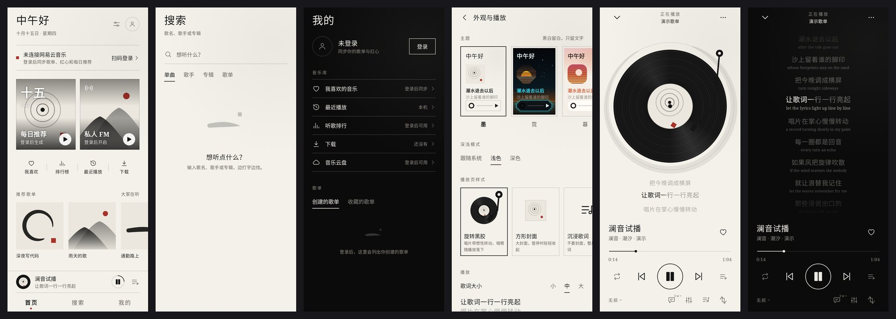

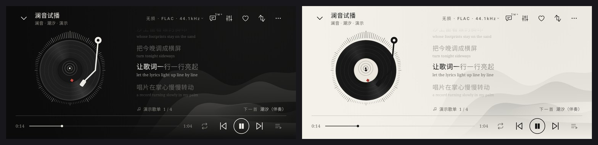

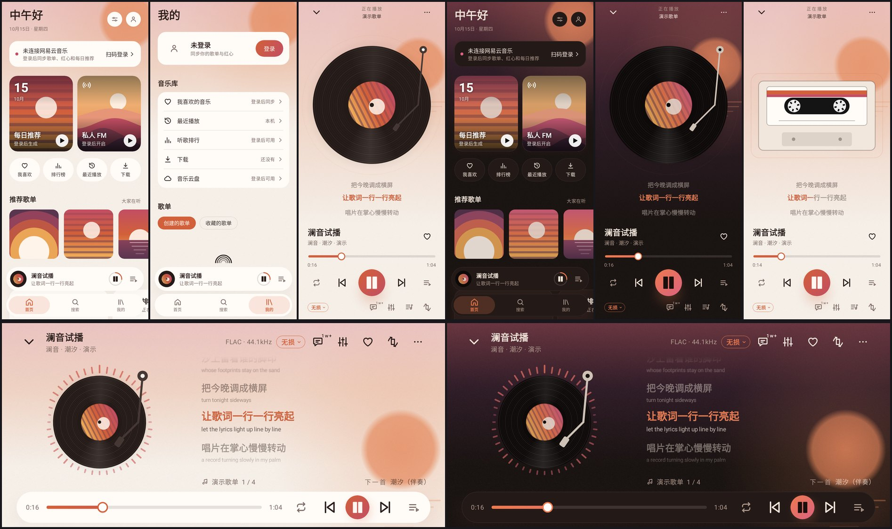

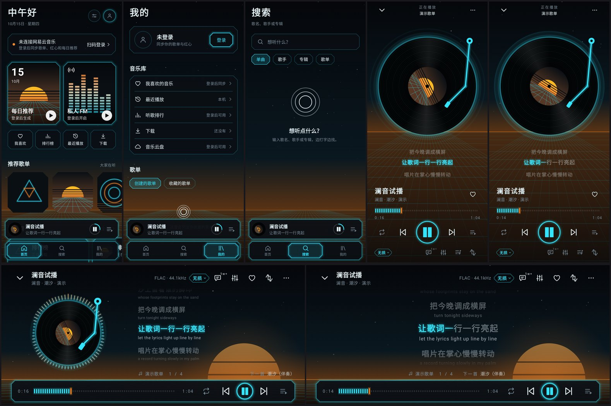

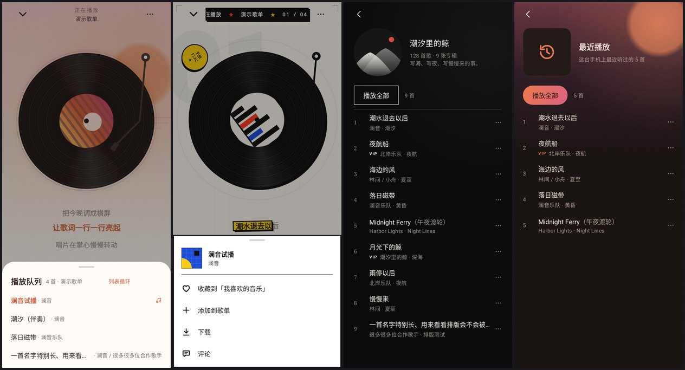

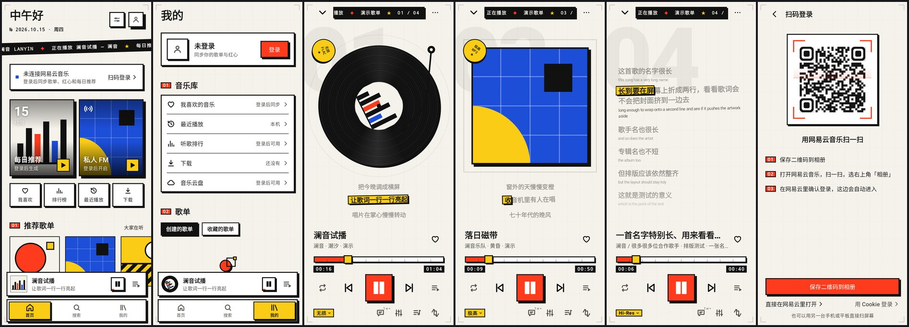

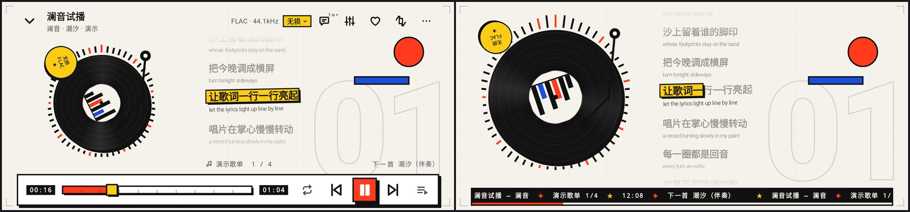

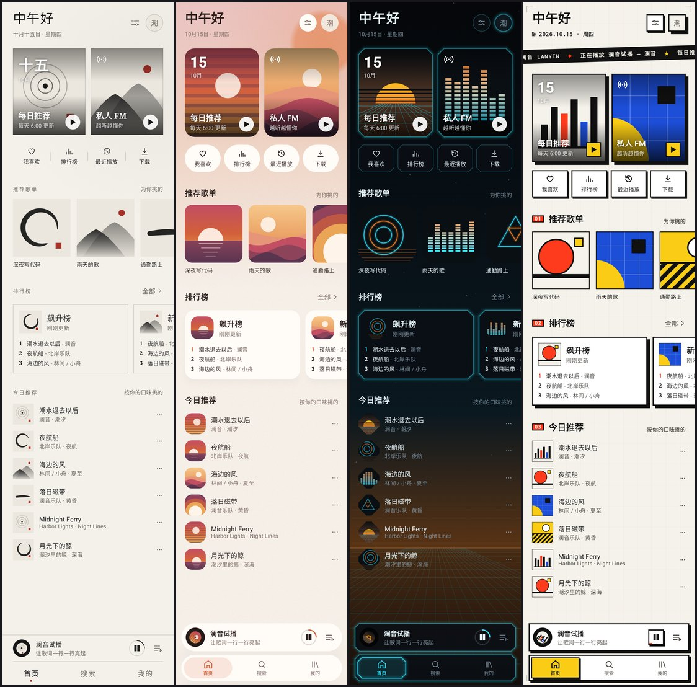

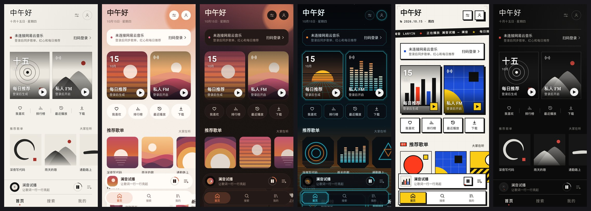

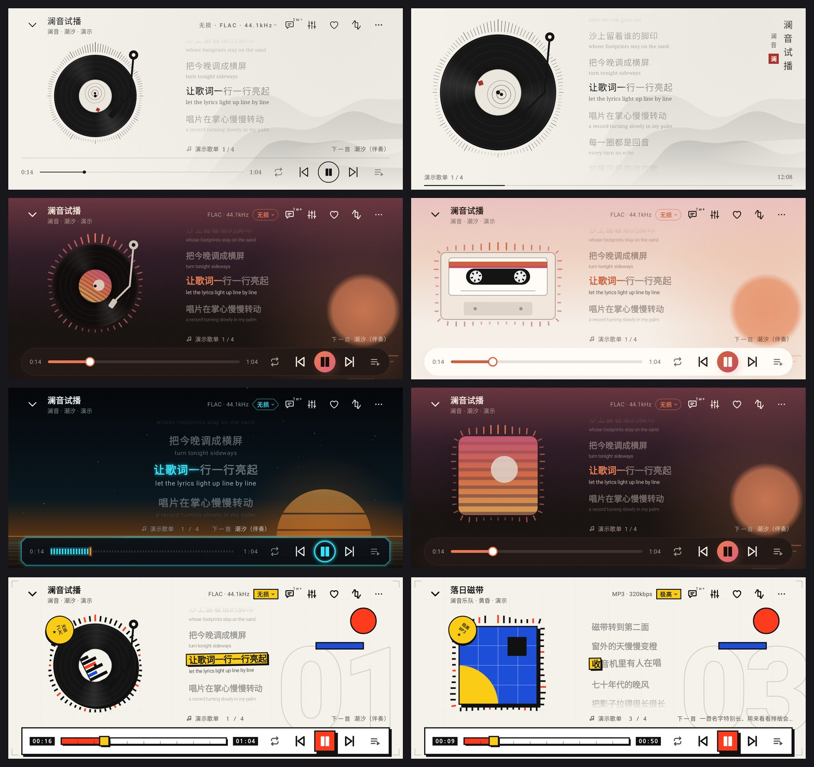

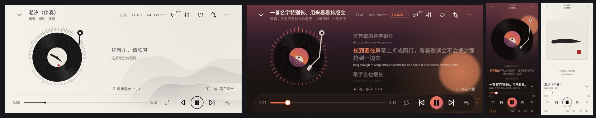

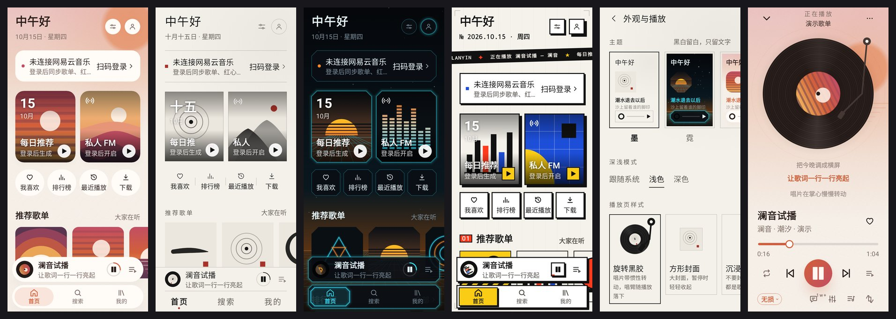

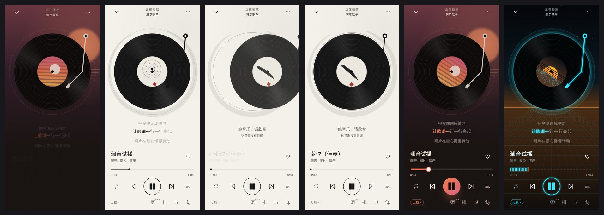

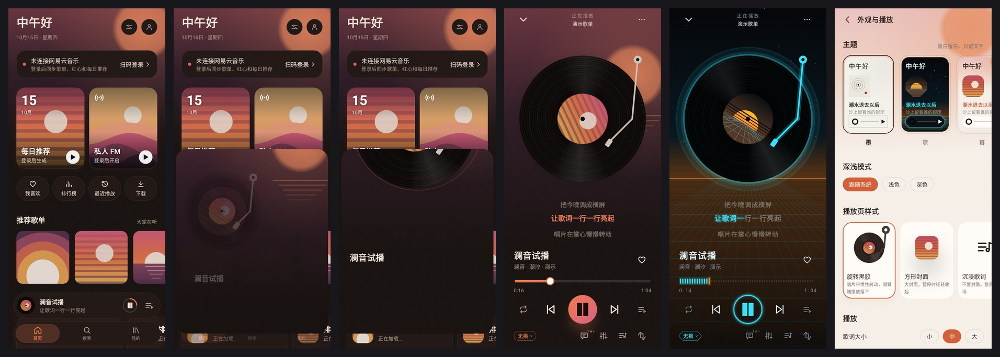

## 网易云音乐

App 直接连网易云（本地实现 eapi / weapi 加密，不经过任何服务器）：

- **登录**：扫码登录，二维码可以存到相册，再用网易云「扫一扫 → 相册」识别（同一部手机扫不了自己的屏幕）；也可以试「直接在网易云里打开」，或者在高级选项里粘贴 `MUSIC_U` Cookie。登录凭证用 Android Keystore 的密钥加密保存，不进备份，只发给网易云。
- **能听的**：首页的每日推荐、私人 FM（不想听的跳过会告诉网易云）、推荐歌单（登录前是热门歌单）、排行榜；「我的」里是我喜欢的音乐、创建和收藏的歌单、最近播放；歌手页（热门歌曲）和专辑页；搜索边打字边出结果，可以搜单曲、歌手、专辑、歌单。点哪首就从哪首开始播放整张列表。
- **播放**：歌曲到要播放时才去要播放地址（网易云的地址二十分钟左右就失效；它的音频节点有的只认 http、有的只认 https，连不上会自动换另一种再试），按设置里的「在线音质」要（默认无损，超清母带要 SVIP），没有就自动降一档；听过的歌存在 1 GB 的缓存里，再听不用流量。没有版权或需要 VIP 的歌会提示原因并跳过。
- **后台**：Media3 播放服务，带通知栏、锁屏控制、蓝牙和耳机按键，拔耳机自动暂停，来电等情况自动让出声音。
- **歌词**：有逐字时间（YRC）的歌，扫色跟着每个字唱到的时刻走，而不是匀速扫过整行；其余用 LRC。翻译按时间对齐，网易云开头的作词作曲信息也会显示；加载中显示「歌词加载中」，纯音乐显示「纯音乐，请欣赏」。
- **队列和「⋯」**：播放页和迷你条的队列按钮打开播放队列（点哪首跳到哪首，可以切播放模式）。播放页和每一行歌后面都有「⋯」：收藏、添加到歌单、下载、看评论、去歌手页或专辑页；在自己的歌单里还能把歌删掉，在云盘里能删文件（删除要点两次）。
- **歌单**：「我的 → 创建的歌单」最上面可以新建歌单（可以设成隐私）；自己的歌单右上角「⋯」能改名、删除；别人的歌单和排行榜可以「收藏」。
- **评论**：播放页的评论按钮上带着数量（「1w+」）。评论页分推荐、最热、最新，往下滑自动加载，点赞立刻生效（网易云不同意会退回去），点一条评论就是回复它。
- **下载**：在「⋯」里下载一首，或者在歌单、专辑、歌手页、每日推荐里「下载全部」。下载交给后台服务，通知栏有进度，退出 App 也会接着下；默认只在 Wi-Fi 下下载。下载完的歌播放时直接读本地，不用网。只能试听的 VIP 歌不会下载（不然存下的是 30 秒片段）。下载的文件在 App 自己的目录里，只在澜音里播放。
- **音乐云盘**：在「我的」里，显示用了多少空间，分页加载，能播放、能删除。上传还没做（可以先用网易云电脑版传）。
- **播放记录**：每首听满半分钟（或短歌的一半）就告诉网易云，账号的「最近播放」和「听歌排行」里会有在澜音听的歌；设置里可以关掉「同步播放记录」。「我的 → 最近播放」可以在「本机」和「网易云」（账号在所有设备上的记录）之间切换；「听歌排行」有最近一周和所有时间。
- **红心**：播放页的红心直接同步到网易云「我喜欢的音乐」。
- **音质**：点播放页上的音质标签（横屏在顶栏）就能换，正在放的歌从当前位置接着放；设置里也能改默认音质。
- **音效**：播放页的音效按钮（或设置里的「音效」）。预设有原声、流行、摇滚、爵士、古典、电子、人声、重低音、柔和、现场、3D 环绕和自定义；十段均衡器可以直接拖，拖了预设就变成你自己的曲线；另有低音增强、环绕（加宽立体声）和混响三个滑块，改了马上就能听到。音效在澜音里用软件处理（不依赖手机厂商的音效接口），耳机和外放都有效，加了限幅不会爆音；选「原声」时音频原样通过，一个字节都不改。

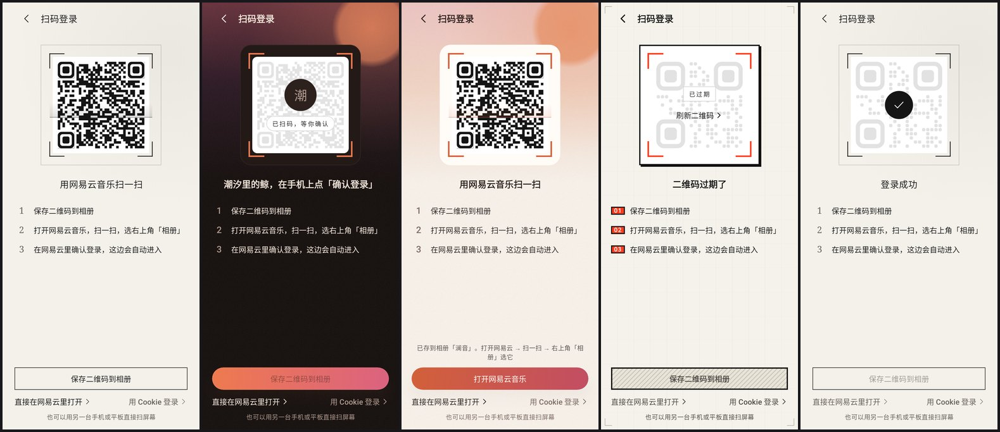

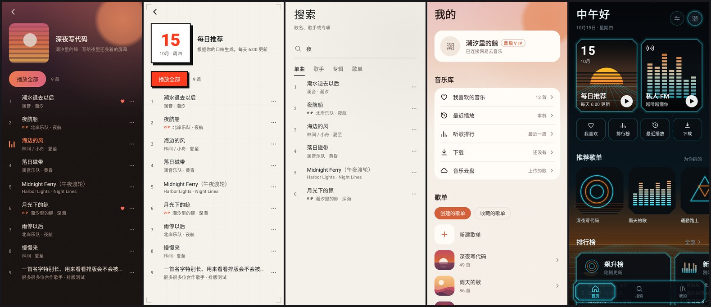

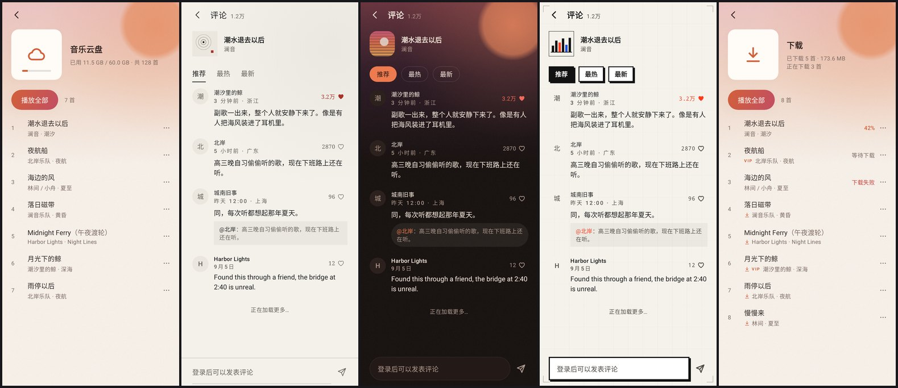

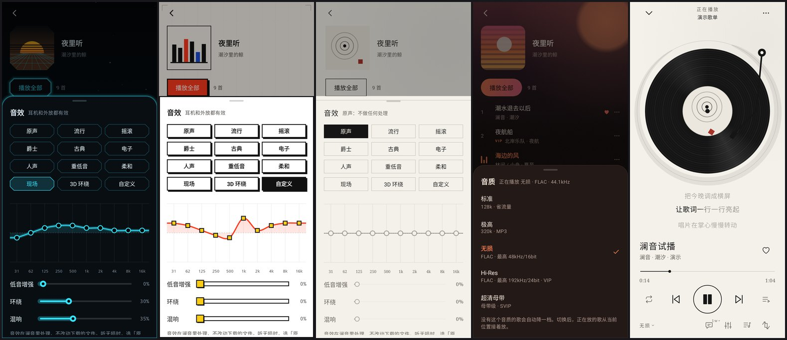

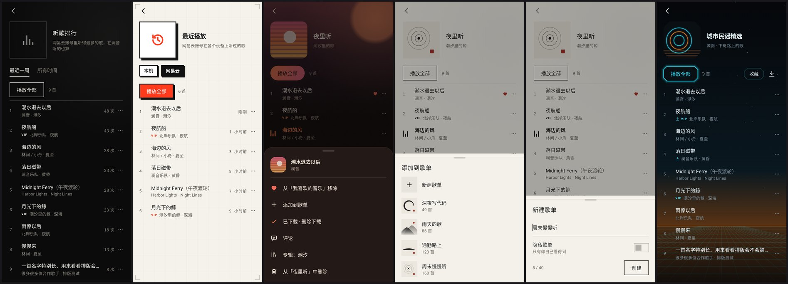

## 主题

每个主题是一整套视觉语言，不只是换颜色：

| 主题 | 风格 | 卡片 | 进度条 | 播放按钮 | 背景 |
|---|---|---|---|---|---|
| **墨**（默认，旗舰） | 黑白、留白、衬线字，唯一的颜色是朱红印章 | 不用卡片，只用发丝线分隔；底栏贴边 | 发丝线 | 线框圆 | 竖屏唱片外一笔圆相；横屏右下远山和雾，全屏时右侧竖排题款加印章 |
| **霓** | 近黑的底色上一种青色霓虹，地平线和落日是琥珀色；只有深色 | 切角、霓虹描边 | LED 灯段 | 发光圆环 | 透视网格（青）和扫描线，地平线泛着琥珀色的光；横屏地平线上一轮条纹落日 |
| **格** | 新粗野瑞士：米白网格纸、纯黑、信号红、克莱因蓝、警示黄；粗黑体大标题，数字和标签用等宽字；只有浅色 | 直角、2.5dp 粗黑边、偏移的硬投影，按下会压进投影；小节标题前是红底编号「01」；首页斜贴一条滚动字幕 | 方块进度条，带刻度和黄色方块拖柄，时间装在黑框里 | 红色方块 | 十二栏网格、基线和裁切角标；播放页印着巨大的曲目编号，横屏再加一个红圆和一道蓝条；封面是四种瑞士海报构图；当前歌词用黄色荧光块逐字划过，整行微微歪着 |
| **暮** | 晚霞：浅色是暖白纸配赤陶橙到玫瑰色，深色是梅子色的夜；无衬线字 | 柔和的暖色投影、圆角，不描边（深色时边上一道很淡的光） | 渐变胶囊（赤陶到玫瑰） | 渐变圆钮 | 从上往下的晚霞色天空、低低的一轮太阳带光晕（播放时轻轻呼吸，横屏在右侧，下面几道水面反光）、胶片颗粒；封面是海上落日、层层山丘、光环和百叶窗里的夕照四种 |

所有主题共用一套规则：四级字号、页边距、一屏一个强调色、同一族自绘线性图标（线宽随主题变化）。每个主题都有四种生成封面构图，推荐歌单不会一排都是同一张图。

主题之外，还可以单独选**播放页样式**：旋转黑胶（默认）、方形封面、沉浸歌词、复古卡带。

### 动效
- 点迷你播放条，它会展开成播放页（容器变形），唱片从缩略图长成大唱片；下拉或系统返回手势会让播放页跟手缩小。
- 唱片有惯性：播放时加速转起，暂停时慢慢停下；唱臂带回弹落下。
- 歌词逐行像波浪一样跟上，当前行略微放大并卡拉 OK 式扫色；字号可以在设置里选小 / 中 / 大（默认 18sp：中文字比同字号的英文更满，主流 App 的歌词也大多在 16–18sp）；歌词大小只听这个设置，不跟系统字体大小走，不然系统字号调大的手机上歌词会大得离谱；可以拖动歌词浏览，松手后自动回到当前行，点某一行跳到那里。
- **滑动切歌**：左右滑动唱片（竖屏、横屏都行）或迷你播放条切到上一首 / 下一首，唱片跟手滑走，下一张从另一边滑进来；用按钮切歌也是同样的方向动画。上一首按钮和多数播放器一样：歌放了 3 秒以上先回到开头。
- 竖屏播放页从上到下：「正在播放 · 歌单名」居中的标题栏，唱片和三行歌词（上一句、当前句、下一句，点一下进入全屏歌词），歌名和歌手，整宽的进度线（时间在线下方，数字等宽不跳动），播放控制，最下面一行是音质标签、歌词和旋转按钮。
- 打开播放页时，标题栏、歌词、歌名、进度、控制按顺序升起；播放时唱片边缘在听到的每一拍荡出一圈涟漪（墨是墨线，霓是发光管，格是方框；没有明显鼓点的歌就很少），暂停时唱片轻轻退后一点。
- 频谱和涟漪跟着真实的声音走：解码出来的音频先经过一个分析器（每 1024 个采样做一次 FFT，折成 32 个频段，用频谱突变找鼓点），结果按音频自己的时间戳存着，再按扬声器此刻在放的位置去取，所以画面对的是正在听到的声音，而不是提前几百毫秒解码出来的那部分。
- 歌词：有逐字时间的歌按字扫色；只有逐行时间的歌，整行在开始时一笔点亮（不知道每个字什么时候唱，匀速扫到下一行会落后于人声）；换行时不再弹跳。
- 切歌时，歌名和歌手顺着切歌方向滑出、新的滑进来，新歌的歌词从下往上依次浮现；当前句亮起时会微微上浮。上一首 / 下一首按钮按下会往对应方向推一下，播放模式图标切换时会弹一下。
- 拖动进度条时，歌词跟着手指走到那一句，松手才真正跳过去。
- 横屏是「顶栏、舞台、控制栏」三段：顶栏左边是收起按钮和歌名（像窗口标题），右边是音质、评论、音效、红心和旋转；舞台左边是封面，外圈一圈频谱随音乐跳动，每个主题画法不同（墨是刻度线，暮是柔和的光线，霓是发光光柱，格是方块条）；右边是歌词，当前句和封面中心对齐，下面一行是歌单来源和下一首。**点舞台空白处切换全屏**，5 秒不碰也会自动全屏：顶栏和控制栏收起，舞台放大，底部只剩一行歌名和时间，加一道进度细线。横屏时隐藏系统栏；也可以在设置里打开「进入播放页时自动横屏」。
- 纯音乐会显示「纯音乐，请欣赏」，超长的歌名、歌手名会省略，长歌词会换行且放大后不出界。
- 系统字体调大时（很多手机默认就偏大）界面跟着放大，卡片和按钮会随文字长高，放不下的文字会省略，不会被切掉；截图测试里有一套 360dp 宽、1.3 倍字号的全页面检查。

## 编译

需要 JDK 17+。

```bash
./scripts/setup-android-sdk.sh      # 安装 Android SDK 到 ~/android-sdk，并写 local.properties
./gradlew assembleDebug             # → app/build/outputs/apk/debug/app-debug.apk（未压缩，约 60 MB）
./gradlew assemblePreview           # → app/build/outputs/apk/preview/app-preview.apk（R8 压缩，约 3 MB，debug 签名，可直接安装）
./gradlew testDebugUnitTest         # 单元测试
./gradlew recordRoborazziDebug      # 在 JVM 上渲染界面截图 → app/build/outputs/roborazzi/（sweep/ 里是每个主题、每种深浅色的全部页面）
NETEASE_LIVE=1 ./gradlew testDebugUnitTest --tests '*NeteaseLiveTest'   # 对真实的网易云服务器跑一遍（匿名注册、二维码、搜索、歌词、榜单、拉一段真实音频）
```

如果 Maven Central 限流（HTTP 429），可以改走 Google 的镜像：

```bash
MAVEN_MIRROR=google ./scripts/setup-android-sdk.sh
export ROBOLECTRIC_REPO_URL=https://maven-central.storage-download.googleapis.com/maven2
```

## 说明

仅供个人使用。用的是网易云的非官方接口，不包含任何绕过会员或付费的功能，VIP 歌曲需要登录的账号本身有对应权限。
